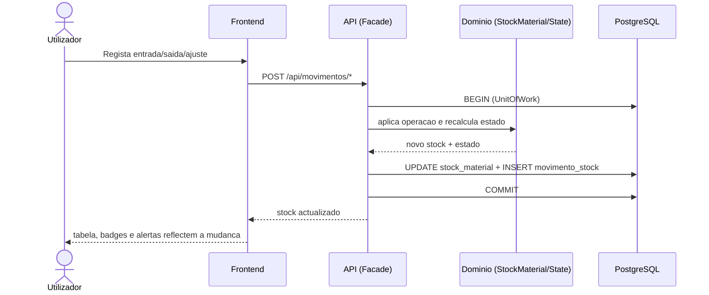

# OficinaGest
## Sistema de Gestão de Inventário para Oficinas

## Índice

1. [Introdução](#1-introdução)
2. [Problema, objectivos e âmbito](#2-problema-objectivos-e-âmbito)
3. [Metodologia de desenvolvimento](#3-metodologia-de-desenvolvimento)
4. [Descrição funcional](#4-descrição-funcional)
5. [Arquitectura do sistema](#5-arquitectura-do-sistema)
6. [Padrões e decisões de projecto](#6-padrões-e-decisões-de-projecto)
7. [Tecnologias e ferramentas](#7-tecnologias-e-ferramentas)
8. [Modelo de dados e persistência](#8-modelo-de-dados-e-persistência)
9. [Segurança, privacidade e limitações](#9-segurança-privacidade-e-limitações)
10. [Instalação e execução](#10-instalação-e-execução)
11. [Testes e critérios de validação](#11-testes-e-critérios-de-validação)
12. [Conclusão](#12-conclusão)

---

## 1. Introdução

Uma oficina mecânica precisa de saber, em qualquer momento, que peças, ferramentas e equipamentos existem, em que quantidade, quem os movimentou e quando. Quando esse controlo fica disperso por cadernos, folhas de cálculo ou memória dos funcionários, tornam-se frequentes três problemas: paragem de serviços por falta de material, compras duplicadas do que já existe em stock, e impossibilidade de rastrear retiradas de material.

O OficinaGest foi desenvolvido para centralizar esses fluxos numa aplicação web full-stack. A aplicação contempla três perfis (Administrador, Atendente e Mecânico), um inventário com estados de stock calculados automaticamente, um histórico auditável de movimentações e um fluxo de requisições em que o mecânico pede material e o atendente ou administrador decide.

Este documento tem finalidade simultaneamente descritiva e técnica: explica como a solução está organizada, quais as decisões arquitecturais e os padrões de projecto identificáveis no código, e que cuidados operacionais (segurança, backup, recuperação) são necessários antes de utilizar o sistema com dados reais de uma oficina.

### 1.1 Organização do relatório

O relatório começa pela definição do problema e dos objectivos. Em seguida descreve as funções, a arquitectura e os padrões utilizados. As secções finais apresentam o modelo de dados, a segurança, a instalação, os testes e a conclusão.

## 2. Problema, objectivos e âmbito

### 2.1 Problema

O problema abordado é a necessidade de apoiar, num único sistema, o registo de materiais e categorias, o controlo de stock com alertas de rutura, o registo auditável de entradas/saídas/ajustes e a coordenação de pedidos de material entre mecânicos e atendentes. O sistema deve ainda separar claramente o que cada perfil pode ver e fazer, e impedir que uma saída deixe o stock negativo ou que um material seja removido sem se saber para onde foi o stock.

### 2.2 Objectivo geral

Desenvolver uma aplicação web que centralize a gestão de inventário de uma oficina, validando no servidor as operações sensíveis (stock, permissões, transições de estado) e limitando os dados e acções disponibilizados a cada perfil.

### 2.3 Objectivos específicos

- Registar materiais classificados por tipo (peça, ferramenta, equipamento) e por categoria gerida pelo utilizador.
- Manter o stock com estados automáticos (Disponível, Stock baixo, Esgotado, Em reposição) e alertas.
- Registar entradas, saídas e ajustes com histórico completo (data, autor, observação).
- Implementar requisições com aprovação, reprovação e devolução por perfil.
- Fornecer um painel de indicadores e relatórios por período exportáveis em PDF.
- Aplicar permissões por perfil tanto na interface como na API.
- Garantir integridade transaccional (stock + histórico), segurança e recuperabilidade.
- Manter documentação, testes automatizados e instruções de execução e implantação.

### 2.4 Âmbito e exclusões

O sistema cobre a gestão operacional de inventário descrita neste documento. A remoção de materiais, categorias e utilizadores é **lógica** (desactivar/reativar), nunca física, preservando o histórico. O estado *Em reposição* é a única transição manual de estado, reservada ao Administrador.

O projecto **não** inclui serviço de email (a recuperação de palavra-passe é administrativa ou via script no servidor), não implementa login social (os botões Microsoft/Google do design estão desactivados por não existir endpoint), e não dispõe de cache, filas de mensagens ou leitura de códigos de barras. Estas exclusões são deliberadas (princípio YAGNI) e estão registadas na secção 9.

## 3. Metodologia de desenvolvimento

A implementação foi organizada por incrementos funcionais, cada um acompanhado de testes automatizados: (i) base de dados, autenticação e CRUD de utilizadores/categorias; (ii) domínio de stock, movimentações e facade de inventário; (iii) requisições, dashboard e relatórios; (iv) interface completa, responsividade, exportação PDF e configurações.

Os fluxos são verificados na fronteira da API, além das validações de interface: o cliente orienta o utilizador, mas a decisão final sobre permissões, stock disponível e transições de estado é do servidor. O repositório contém testes unitários de domínio (Vitest), testes de integração contra uma base de dados PostgreSQL real (concorrência e atomicidade) e testes de componentes/permissões no frontend (Testing Library + MSW).

Não há neste repositório evidência de um processo formal de recolha de requisitos com participantes externos, estudo de usabilidade ou validação institucional. Por isso, as afirmações deste relatório limitam-se às funções implementadas e aos testes presentes.

## 4. Descrição funcional

### 4.1 Módulos principais

| Módulo | Responsabilidade |
|---|---|
| Dashboard | Indicadores (totais, stock baixo, esgotado, em reposição, entradas/saídas do dia), gráfico de 7 dias, alertas e acções rápidas por perfil. |
| Inventário | Listar, criar, editar, desactivar/reativar materiais; pesquisa global, filtros por tipo/categoria/estado e paginação. |
| Movimentações | Registar entradas, saídas e ajustes (ADMIN); consultar histórico completo. |
| Requisições | Mecânico cria pedido; atendente/admin aprova, reprova ou marca como devolvido. |
| Relatórios | Totais e gráficos por período (diário/semanal/mensal), top-10 materiais, exportação PDF com logótipo e paginação. |
| Utilizadores | CRUD de contas e perfis (ADMIN); desactivar/reativar. |
| Categorias | CRUD de famílias de materiais (ADMIN); desactivar/reativar. |
| Configurações | Estado do sistema, aparência (tema), exportação JSON de dados (ADMIN) e informações gerais. |

### 4.2 Percurso do stock e da movimentação

O servidor valida a quantidade (inteira e positiva), a existência do material e, nas saídas, a disponibilidade de stock. Cada movimento actualiza o stock, recalcula o estado pelo domínio e grava uma linha no histórico com data, autor e observação — tudo dentro da mesma transacção. Um ajuste exige observação obrigatória e é restrito ao Administrador; uma saída que exceda o stock é recusada com erro 409 STOCK_INSUFICIENTE, traduzido na interface para uma mensagem amigável.



### 4.3 Percurso da requisição

O mecânico cria uma requisição indicando material e quantidade; o pedido fica *Pendente*. O atendente ou administrador aprova ou reprova; uma requisição aprovada pode ser marcada como *Devolvida*. O mecânico vê apenas as suas requisições; o atendente/admin vê todas. As transições de estado da requisição são validadas no servidor (não é possível aprovar uma requisição já fechada).

### 4.4 Perfis e permissões

As permissões são verificadas no servidor. A interface adapta a navegação e os botões ao perfil, mas ocultar um botão não substitui a autorização da API.

| Área | Administrador | Atendente | Mecânico |
|---|:---:|:---:|:---:|
| Dashboard / Inventário (consulta) | Sim | Sim | Sim |
| Gerir materiais / categorias | Sim | Não | Não |
| Registar movimentos / ver histórico | Sim | Sim | Não |
| Criar requisições | Sim | Não | Sim |
| Aprovar / reprovar / devolver requisições | Sim | Sim | Não |
| Relatórios | Sim | Não | Não |
| Gerir utilizadores | Sim | Não | Não |
| Configurações pessoais (tema, sobre) | Sim | Sim | Sim |
| Exportar dados (backup JSON) | Sim | Não | Não |

## 5. Arquitectura do sistema

### 5.1 Visão geral

A aplicação é composta por um backend Node.js/Express e um frontend React/Vite, implantados como serviços distintos em desenvolvimento (proxy /api) e combináveis em produção. O backend segue uma **arquitectura em camadas com núcleo rico**, inspirada em Clean Architecture e DDD, com uma regra de dependência unidireccional: as camadas interiores não conhecem as exteriores. Esta descrição não implica microserviços nem DDD completo (ver 9.2).

### 5.2 Backend

| Camada | Localização | Papel |
|---|---|---|
| Domain | backend/src/domain/ | Entidades, value objects e regras puras; não importa Express, pg nem configuração. |
| Application | backend/src/application/ | Casos de uso, serviços, Facade e ports (interfaces). Orquestra o domínio. |
| Infrastructure | backend/src/infrastructure/ | Implementação dos ports (PostgreSQL), hash e Unit of Work. |
| Presentation | backend/src/presentation/ | Rotas HTTP, DTOs validados com zod e middlewares (auth, perfil, rate-limit, erros). |

A composição ocorre em backend/src/main.ts (composition root), único ponto onde implementações concretas são ligadas às abstrações por injecção via construtor. A prova da separação é visível nos imports: domain/material/MaterialFactory.ts não referencia nenhum módulo de infraestrutura.

### 5.3 Frontend

O frontend está em frontend/src/, organizado por funcionalidade. Cada ecrã (funcionalidades/<dominio>/pagina.tsx) consome uma camada de dados (hooks.ts, TanStack Query), valida com schema.ts (zod) e comunica através de api/cliente.ts. A segurança vive em auth/ (AuthProvider, RotaProtegida, permissoes); a apresentação reutilizável em componentes/ e layout/. O MSW simula a API em desenvolvimento opcional e nos testes de componentes.

### 5.4 Arquitectura de um pedido HTTP

1. O middleware de autenticação valida o JWT no cookie httpOnly.
2. O middleware de perfil verifica a autorização da rota.
3. O DTO (zod) valida a entrada; entrada inválida é rejeitada antes do domínio.
4. O serviço/facade aplica as regras do domínio e, quando necessário, abre transacção.
5. O repositório carrega ou persiste o estado via SQL parametrizado.
6. A API devolve JSON com o resultado ou um erro HTTP estruturado.

### 5.5 Principais rotas da API

| Método e caminho | Acesso | Finalidade |
|---|---|---|
| GET /api/health | Público | Verificar disponibilidade do servidor. |
| POST /api/auth/login | Público (rate-limit) | Iniciar sessão; cookie httpOnly. |
| POST /api/auth/logout e GET /api/auth/me | Sessão | Terminar / consultar sessão. |
| GET/POST/PUT/DELETE /api/utilizadores | ADMIN | CRUD de contas; POST /:id/reativar. |
| GET/POST/PUT/DELETE /api/categorias | ADMIN (escrita) | CRUD de categorias; POST /:id/reativar. |
| GET/POST/PUT/DELETE /api/materiais | Sessão / ADMIN (escrita) | CRUD de materiais; reactivar; iniciar/cancelar reposição. |
| POST /api/movimentos/entradas, /saidas, /ajustes | Sessão / ADMIN (ajustes) | Registar movimentos com histórico. |
| GET /api/movimentos | Sessão | Histórico de movimentações. |
| GET/POST /api/requisicoes; PATCH /:id/aprovar, /reprovar; POST /:id/devolver | Por perfil | Fluxo de requisições. |
| GET /api/dashboard/resumo | Sessão | Indicadores, série de 7 dias, alertas. |
| GET /api/relatorios/movimentos | ADMIN | Relatório por período com totais e top-10. |

## 6. Padrões e decisões de projecto

### 6.1 Princípios adoptados

| Princípio | Onde e como foi aplicado | Porquê |
|---|---|---|
| Separação de responsabilidades | Backend em domain/application/infrastructure/presentation; frontend por funcionalidade com view/hooks/schema/api. | Cada parte é mais fácil de compreender, testar e alterar. |
| Segurança no servidor e privilégio mínimo | exigirPerfil na API; RotaProtegida e matriz permissoes.ts no frontend. | A interface pode ser manipulada; a API é a autoridade final. |
| Integridade e validação no servidor | zod nos DTOs; VOs auto-validados; transições de estado no domínio; UnitOfWork para stock+histórico. | Evitar depender de validações apenas visuais. |
| Auditabilidade e preservação do histórico | Toda a movimentação grava data/autor/observação; remoções são lógicas. | A oficina precisa de contexto operacional ao longo do tempo. |
| Encapsulamento | Campos internos _x com getters públicos em Quantidade/StockMaterial. | Proteger invariantes e evitar acesso indevido a estado interno. |
| Entrega incremental com testes | Cada incremento acompanhado de testes unitários/integração/componentes. | Reduzir risco de regressões e documentar comportamento esperado. |

### 6.2 Padrões e implementação

| Categoria | Padrão | Onde se aplicou e como | Porquê |
|---|---|---|---|
| Criacional | Factory Method | domain/material/MaterialFactory.ts escolhe Peca/Ferramenta/Equipamento a partir do tipo e injecta-o nas props. | Centralizar a decisão de criação; novo tipo = nova classe + um caso, sem tocar nos chamadores (OCP). |
| Comportamental | State | domain/stock/StatusStock.ts modela cada estado como classe com métodos de transição; StockMaterial delega (_estado.aposEntrada(...)). | Eliminar switch espalhado; transições polimórficas e testáveis (matriz estado x evento). |
| Estrutural | Facade | application/InventarioFacade.ts expõe operações compostas (movimentos, reposição, desativação) que orquestram transacção + stock + histórico + validações. | Interface simples para um subsistema complexo; a rota não conhece o UnitOfWork. |
| Dados | Repository | Ports em application/ports/*Repository.ts; implementações infrastructure/repositories/Pg*Repository.ts. | Isolar o domínio da persistência; trocar o banco sem reescrever regras. |
| Dados | Unit of Work | infrastructure/database/PgUnitOfWork.ts compra/entrega um client e faz BEGIN/COMMIT/ROLLBACK. | Atomicidade de stock + histórico (ou entram os dois, ou nenhum). |
| Comportamental | Strategy | application/ports/HashDePassword.ts implementado por infrastructure/security/BcryptHasher.ts. | Trocar o algoritmo de hash sem tocar nos serviços de autenticação. |
| Value Object | Value Object | domain/stock/Quantidade.ts imutável e auto-validado (RN08/RN11). | Garantir invariantes numéricas num único ponto. |
| Estrutural | Adapter / DTO | paraDominio (linha SQL para entidade), resumoPublico() (entidade para JSON), DTOs zod (HTTP para aplicação). | Converter entre representações incompatíveis sem expor o modelo interno. |
| Transversal | Middleware (pipeline) | presentation/middlewares/{auth,perfil,rateLimitLogin,errorHandler}.ts. | Tratar preocupações transversais (auth, autorização, limite, erros) fora das rotas. |
| Integração | Injecção de dependências / Composition Root | main.ts instancia e injecta hasher, repositórios, serviços, facade e rotas. | Materializar a inversão de dependências e permitir testes com substitutos. |

Os nomes acima descrevem padrões observáveis no código. Em particular, o padrão State é implementado com classes de estado distintas (não apenas um switch), e a Factory Method é demonstrada por testes de instanceof por tipo.

### 6.3 SOLID no projecto

| Letra | Correspondência verificável |
|---|---|
| S — Responsabilidade única | Quantidade valida números; StatusStock decide transições; MaterialService orquestra CRUD; rotas fazem HTTP. |
| O — Aberto/fechado | Novo tipo de material = nova classe + caso na factory; novo estado = nova classe; novo perfil = linha na matriz. |
| L — Substituição de Liskov | Peca/Ferramenta/Equipamento substituem Material; chamadores usam resumoPublico() polimórfico. |
| I — Segregação de interfaces | Ports pequenos (HashDePassword com dois métodos; repositórios com o necessário). |
| D — Inversão de dependências | A aplicação depende de interfaces; a infraestrutura implementa-as; main.ts injecta o concreto. |

## 7. Tecnologias e ferramentas

| Tecnologia | Utilização |
|---|---|
| Node.js + TypeScript | Runtime e linguagem do backend. |
| Express | Servidor HTTP, rotas e middlewares. |
| PostgreSQL + node-pg-migrate | Persistência relacional e migrações versionadas. |
| bcrypt + jsonwebtoken | Hash de palavras-passe e sessão JWT em cookie httpOnly. |
| zod | Validação de entrada nos DTOs. |
| React 18 + Vite | Frontend e compilação. |
| Tailwind CSS | Estilos e tokens de tema (claro/escuro). |
| TanStack Query + React Router | Dados/cache e navegação protegida. |
| React Hook Form + Zod | Formulários e validação no cliente. |
| Recharts | Gráficos do dashboard e relatórios. |
| jsPDF + jspdf-autotable | Exportação de relatórios em PDF (logótipo + paginação). |
| Vitest + Testing Library + MSW | Testes unitários, de componentes e simulação da API. |

As versões exactas encontram-se nos package.json e package-lock.json de cada pacote.

## 8. Modelo de dados e persistência

### 8.1 Tabelas principais

| Tabela | Conteúdo |
|---|---|
| usuario | Contas, perfil (enum), hash de palavra-passe, estado activo. |
| categoria_material | Famílias de materiais, descrição única, estado activo. |
| material | Código único, nome, tipo (enum), categoria (FK), unidade, estado activo. |
| stock_material | Quantidade, stock mínimo, estado (enum), datas da última entrada/saída (1:1 com material). |
| movimento_stock | Histórico: material, tipo (enum), quantidade, autor, observação, data. |
| historico_alteracao_material | Registo de alterações de cadastro (campo, valor antigo/novo, autor). |
| requisicao | Pedido: material, mecânico, atendente (nullable), quantidade, estado (enum), data. |

### 8.2 Relações e enums

- material.id_categoria referencia categoria_material.id; stock_material.id_material referencia material.id.
- movimento_stock.id_material referencia material.id e id_usuario referencia usuario.id.
- requisicao.id_material referencia material.id, id_mecanico referencia usuario.id, id_atendente referencia usuario.id.
- Enums: perfil_usuario, tipo_material, estado_stock, tipo_movimento, estado_requisicao.

As migrações são geridas por node-pg-migrate (backend/migrations/). O SQL é sempre parametrizado; não há concatenação de strings com entrada do utilizador.

### 8.3 Variáveis de ambiente

Backend: DATABASE_URL, DATABASE_URL_TESTE, JWT_SECRET, PORT, CORS_ORIGIN, NODE_ENV. Frontend: VITE_USE_MOCKS (true = dados simulados; false = backend real via proxy /api). Os ficheiros .env são ignorados pelo Git; apenas .env.example é versionado.

## 9. Segurança, privacidade e limitações

### 9.1 Protecções implementadas

- Palavras-passe derivadas com **bcrypt**; sessão via **JWT em cookie httpOnly + SameSite=Lax** (Secure em produção).
- **Rate limiting** no login: 5 tentativas/15 min por IP em produção (100 em desenvolvimento).
- **RBAC em três níveis**: menu (UI), RotaProtegida (frontend) e exigirPerfil (API).
- Validação de entrada com **zod**; SQL parametrizado; stock nunca negativo; saídas validadas contra disponibilidade.
- **Remoção lógica** de materiais/categorias/utilizadores, preservando histórico e integridade referencial.
- **Recuperação de palavra-passe**: outro ADMIN repõe via UI; em emergência, npm run reset-password -- <username> <novaPassword> no servidor (break-glass, exige acesso à máquina).
- Backup com pg_dump -Fc e restauro com pg_restore; exportação JSON no ecrã Configurações (ADMIN) como cópia rápida.

### 9.2 Limitações importantes

- Não é DDD completo: sem Domain Events, Bounded Contexts, Specification Pattern ou CQRS; é arquitectura em camadas com núcleo rico inspirada em DDD.
- Sem cache, filas de mensagens ou event sourcing (YAGNI).
- Sem serviço de email: não há fluxo automático de "esqueci-me"; a recuperação é administrativa ou via script.
- Login social (Microsoft/Google) presente no design mas desactivado (sem endpoint).
- Os testes de integração cobrem fluxos críticos (concorrência/atomicidade), não 100% dos endpoints.
- O rate-limit e a sessão são locais ao processo; em produção com múltiplas instâncias seria necessário um store partilhado.

**Antes de usar com dados reais de uma oficina**, recomenda-se definir JWT_SECRET forte, NODE_ENV=production, CORS_ORIGIN correcto, agendar pg_dump periódico e validar o restauro. Para demonstrações, utilizar os dados fictícios do seed.

## 10. Instalação e execução

### 10.1 Requisitos

- Node.js 20 ou superior; npm compatível com os lockfiles.
- PostgreSQL 14 ou superior; bases oficinagest (dev) e oficinagest_teste (testes) criadas.

### 10.2 Backend

```bash
cd backend
npm install
cp .env.example .env      # ajustar DATABASE_URL, JWT_SECRET, PORT, CORS_ORIGIN
npm run migrar            # aplica migrações
npm run seed              # utilizadores + categorias + materiais de exemplo (idempotente)
npm run dev               # http://localhost:3000
```

### 10.3 Frontend

```bash
cd frontend
npm install
cp .env.example .env      # VITE_USE_MOCKS=false para usar o backend real
npm run dev               # http://localhost:5173 (proxy /api -> :3000)
```

### 10.4 Credenciais iniciais (seed)

| Utilizador | Palavra-passe | Perfil |
|---|---|---|
| admin | admin123 | Administrador |
| atendente | atend123 | Atendente |
| mecanico | mec123 | Mecânico |

### 10.5 Comandos úteis

```bash
npm test                      # unitários (backend ou frontend)
npm run test:integracao       # integração contra BD real (backend)
npm run build                 # compilação de produção
npm start                     # servir backend compilado
npm run reset-password -- <username> <novaPassword>   # recuperação (backend)
```

### 10.6 Backup e restauro

```bash
pg_dump -Fc -d oficinagest -f oficinagest.backup
createdb oficinagest_restaurada
pg_restore -d oficinagest_restaurada oficinagest.backup
```

## 11. Testes e critérios de validação

Os testes unitários de domínio (Vitest) cobrem, entre outros:

- Quantidade (inteiro/não-negativo/positivo), StatusStock (matriz completa de transições estado x evento), StockMaterial (delegação ao State), ValidadorDeMovimentoStock.
- MaterialFactory (subtipo correcto por tipo; erro para tipo inválido).
- Requisicao (transições válidas/inválidas) e InventarioFacade (ciclo entrada, saida, ajuste, reposição com coerência de stock+histórico).

Os testes de integração correm contra uma base PostgreSQL real e verificam concorrência e atomicidade de transacções (stock + histórico). No frontend, os testes cobrem badges de estado, botões de reposição por perfil/estado, matriz de permissões, RotaProtegida (redireccionamento e bloqueio) e o formulário de saída (validação inteiro>0 e tratamento do 409).

A compilação de produção é validada com npm run build em ambos os pacotes. Os testes automatizados não equivalem a auditoria de segurança, teste de carga ou avaliação de usabilidade com utilizadores reais.

## 12. Conclusão

O OficinaGest implementa uma base funcional para centralizar a gestão de inventário de uma oficina, com API e interface distintas, organização do backend por camadas e controlo de acesso por perfil. Entre as decisões relevantes estão a separação de responsabilidades (domain/application/infrastructure/presentation), a validação de regras no servidor, a atomicidade de stock+histórico via Unit of Work e a aplicação deliberada de padrões de projecto (Factory Method, State, Facade, Repository, Strategy, Value Object) demonstrada por testes.

A escolha por remoção lógica, histórico auditável e recuperação administrativa reforça a integridade e a rastreabilidade exigidas num contexto operacional real. As limitações identificadas (ausência de email, login social desactivado, sem cache/filas) são deliberadas e documentadas, constituindo pontos de evolução futura (notificações por email, multi-oficina, leitura de códigos de barras) sem comprometer a coerência da arquitectura actual.

Conclui-se que o projecto reúne funcionalidades úteis e uma arquitectura compreensível e testável, pronta para uso numa oficina mediante a configuração de segurança e backup descrita neste relatório.